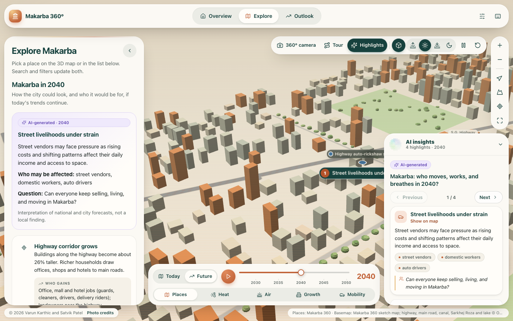
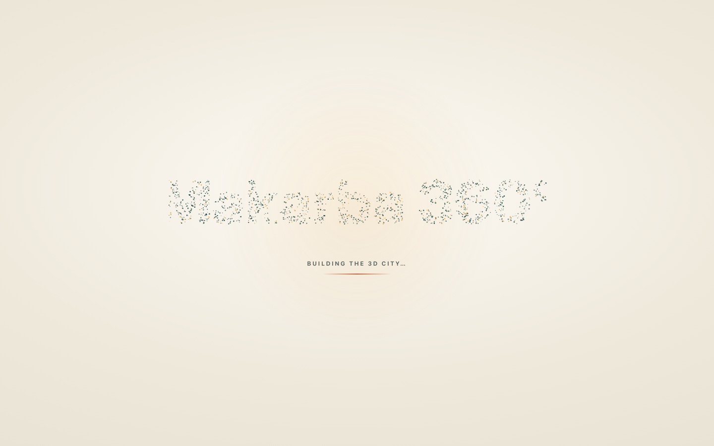
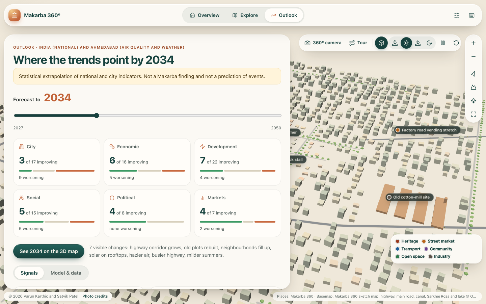
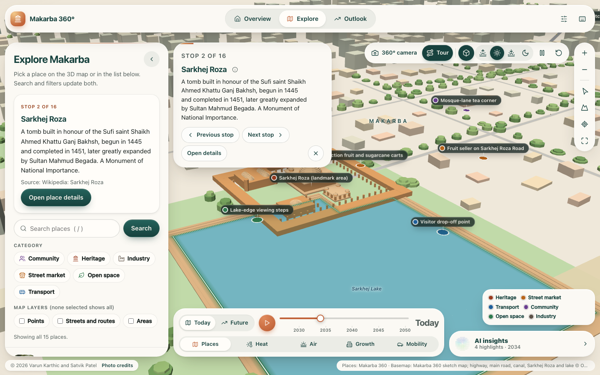
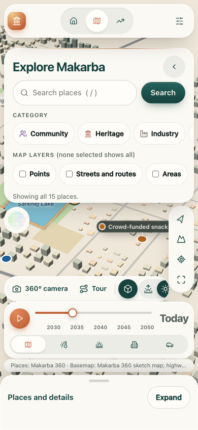
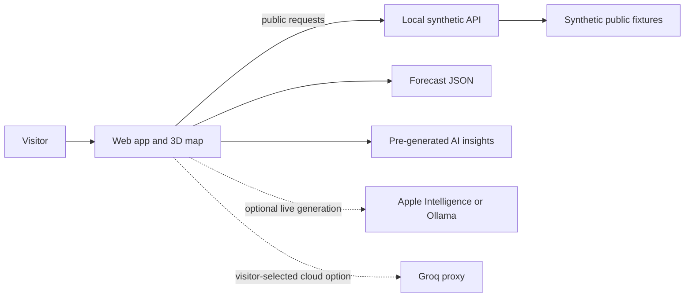
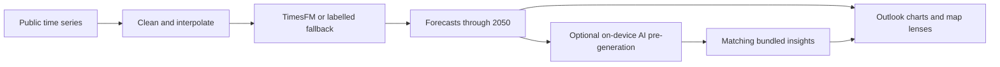

# Makarba 360°

[](https://github.com/satvikp-coder/makarba-360/actions/workflows/ci.yml) [](https://github.com/satvikp-coder/makarba-360/actions/workflows/planning.yml)  

**Live demo (synthetic data): https://makarba-360.onrender.com** · deployed from [`render.yaml`](render.yaml) (free tier: the first load after idle can take about a minute while the mock API wakes).

**A participatory urban atlas of Makarba, Ahmedabad: places, history, community voices and where the trends point.**

Explore the neighbourhood as a living 3D city, follow a guided tour of its landmarks, and see an illustrative picture of how it could change by 2034 (or any year to 2050), driven by Google TimesFM forecasts of real public data.



---

## Quick start

```bash
./run.sh            # macOS / Linux
run.bat             # Windows
```

Open [http://localhost:5173](http://localhost:5173). You need Node 22+ and pnpm (`corepack enable`). The launcher installs dependencies on first run. The mock API root redirects to the app. Set `WEB_PORT` or `MOCK_API_PORT` if the default ports are busy.

| Command | What it does |
|---|---|
| `./run.sh` / `run.bat` | The app: local API, web app, the Apple Intelligence bridge (macOS) and Ollama if installed |
| `./run.sh forecast` | Regenerates the forecasts with TimesFM (Python 3.11; downloads the model on first run) |
| `./run.sh check` | Runs typecheck, lint and all unit tests |
| `./run.sh db` / `api` | Runs the PostGIS container or the real API (Docker and a `.env` file) |

Full guide: **[How to use](docs/operations/how-to-use.md)**.

## What's inside

| | |
|---|---|
| **One live 3D map** | The map fills the screen and stays loaded between pages; everything else floats over it as cards. A particle start-up film lands on the map's own roads. Sarkhej Roza, its tank, the S.G. Highway, the Sarkhej road and the canal follow **OpenStreetMap**. |
| **Explore** | Search and filter the places; selecting one flies there and traces its footprint. **Tour** visits each landmark (places at a landmark are part of its stop). The **360° camera** is on by default: when you stop interacting, the view turns slowly around what is in front of you. |
| **Future scene and timeline** | A Cesium-style time dock: pick a year and the city animates to it year by year, forwards or back, or press **Play**. Data lenses (Heat, Air, Growth, Mobility) recolour the map and show the number behind the colour. Every change is explained through people: who gains, who bears the cost, and the right-to-the-city question it raises. |
| **Outlook** | 78 indicators in five themes (85 in six with the optional markets file) with charts, an 80% range, units and plain-language tags, from 2027 to 2050 (default 2034). |
| **AI insights** | Browse pre-generated highlights with Previous and Next; the selected insight appears beside its map anchor. Missing years can be generated live (Apple Intelligence, then Ollama; Groq only on request). Answers are labelled **AI-generated**, and cached answers are tied to the forecast contents. The bundled file currently has no 2049 entry. |
| **Then & Now, Voices, Insights, Research** | Evidence-led history, community stories, privacy-safe aggregates and the research method, all in one calm reading layout. |









### Around Makarba


Sarkhej Roza, 2011. Photo by [Museeb fakih, via Wikimedia Commons](https://commons.wikimedia.org/wiki/File:Sarkhej.JPG), public domain; resized for the atlas. See [media credits](docs/project/media-credits.md) for the other photographs and their licences.

## How the pieces fit



The default launcher uses synthetic public fixtures. The real API and private research workflow have separate operational and approval gates; the diagram does not imply that fieldwork or publication has been approved.

## Forecasting

| Source | What | Licence |
|---|---|---|
| World Bank Open Data | India economic, development, social and political indicators | CC BY 4.0 |
| Worldwide Governance Indicators | India governance indicators | CC BY 4.0 |
| Kaggle, CPCB air quality | Ahmedabad air-quality series (monthly) | CC0 |
| Kaggle, India weather | Ahmedabad heat and rainfall series (annual) | MIT |
| Yahoo Finance (optional) | NIFTY indices, USD/INR, oil, gold; git-ignored, personal use | Yahoo terms |

**Model:** Google **TimesFM 3.0** (zero-shot). Every series is forecast once to 2050 with a 10th–90th percentile band. The year slider reads a prefix of that forecast, which is identical to re-running with a shorter horizon.
**Details:** [ml/README.md](ml/README.md), and the *Model & data* tab in the app.



**AI providers:** Apple Intelligence runs through a small local Swift bridge (`tools/applefm/server.swift`, 127.0.0.1 only), which `./run.sh` builds and starts on macOS 26+. Ollama needs no setup beyond a model. For Groq, add `GROQ_API_KEY=…` to `apps/web/.env.local` (git-ignored); the dev server attaches the key to requests, so it never reaches the browser.

## Repository

```
apps/web          public site (React, Vite, MapLibre 3D, offline basemap)
apps/api          shared backend and synthetic mock API
packages/*        contracts, auth/authz, survey, GIS I/O, insights, place content, …
ml/               TimesFM forecasting pipeline and tests
db/, deploy/      migrations, nginx/CSP and deployment config
docs/             product, architecture, research, operations and project records
run.sh, run.bat   launchers
```

**Checks:** `pnpm typecheck && pnpm lint && pnpm test` for unit tests, `pnpm --filter @makarba/web test:e2e` for browser tests (accessibility, offline map, journeys), and `python -m pytest ml` for the pipeline.

## Principles

- **Researcher-only collection.** Trained researchers interview people face to face. There is **no public survey submission**.
- **Privacy by design.** Interview position and discussed place are stored separately. Raw responses, exact interview GPS, consent records and original media stay private. Only allowlisted, reviewed aggregates are published.
- **Honest data.** Synthetic examples are disclosed on every page. Forecasts are labelled as national or city trends, and AI text as AI-generated.
- **External gates before real fieldwork:** institutional ethics and legal approval, a verified study boundary, and offline security validation.

The repository is **public** at the owner's request. This does not make research records or the future field and admin apps public ([visibility decision](docs/project/visibility-decision.md)). No source licence has been chosen yet. Third-party data and media keep their own licences.

## Project docs

- **Product and design:** [requirements](docs/product/requirements.md) · [UX screens](docs/product/screen-inventory.md) · [architecture](docs/architecture/overview.md) · [data model](docs/architecture/data-model.md)
- **Planning:** [roadmap](docs/project/roadmap.md) · [issue index](docs/project/issue-index.md) · [open issue status](docs/project/open-issues-status.md) · [setup progress](docs/project/setup-progress.json)
- **Team:** Varun is Developer A (core platform) and Satvik is Developer B (public experience). See [workstreams](docs/project/two-developer-workstreams.md) · [A guide](docs/project/DEVELOPER_A_GUIDE.md) · [B guide](docs/project/DEVELOPER_B_GUIDE.md) · [handoffs](docs/project/developer-handoffs.md) · [ownership swap](docs/project/OWNERSHIP_SWAP_REPORT.md)
- **Sources:** the 23-page blueprint was read in full; see [source provenance](docs/source/README.md) and [traceability](docs/project/traceability-matrix.md). Media credits are in [media-credits](docs/project/media-credits.md).

Releases: **A** technical foundation → **B** private offline-capable fieldwork MVP → **C** approved public demonstration.
