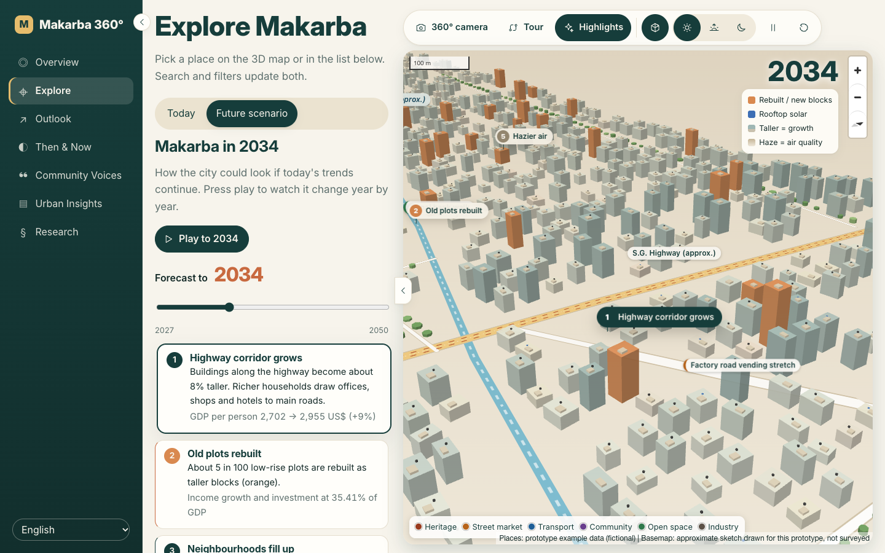
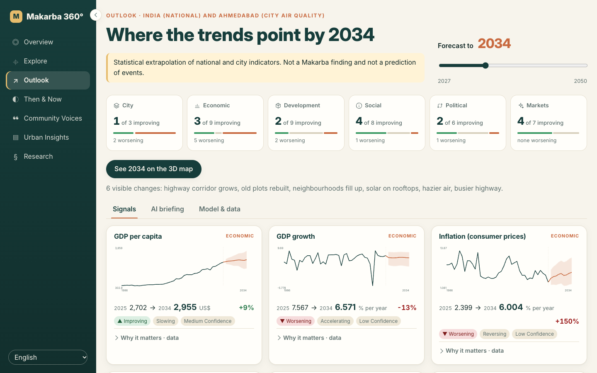
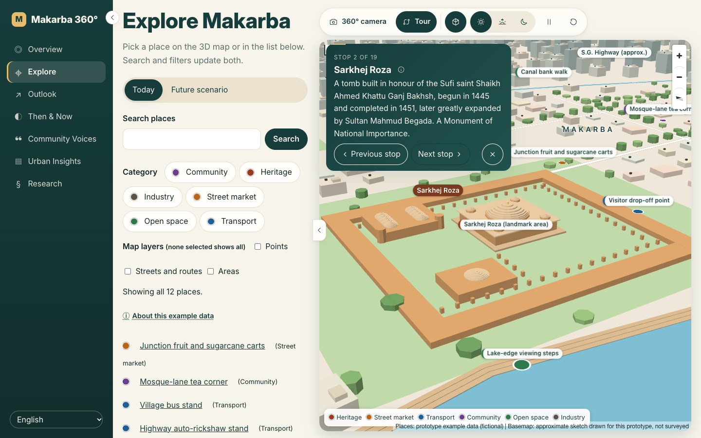

# Makarba 360°

**A participatory urban atlas of Makarba, Ahmedabad: places, history, community voices and where the trends point.**

Explore the neighbourhood as a living 3D city, follow a guided tour of its landmarks, and see an illustrative picture of how it could change by 2034 (or any year to 2050), driven by Google TimesFM forecasts of real public data.



---

## Quick start

```bash
./run.sh            # macOS / Linux
run.bat             # Windows
```

Open the URL Vite prints (usually http://localhost:5173). You need Node 22+ and pnpm (`corepack enable`). The launcher installs dependencies on first run.

| Command | What it does |
|---|---|
| `./run.sh` / `run.bat` | The app: local API, web app, the Apple Intelligence bridge (macOS) and Ollama if installed |
| `./run.sh forecast` | Regenerates the forecasts with TimesFM (Python 3.11; downloads the model on first run) |
| `./run.sh check` | Runs typecheck, lint and all unit tests |
| `./run.sh db` / `api` | Runs the PostGIS container or the real API (Docker and a `.env` file) |

Full guide: **[How to use](docs/operations/how-to-use.md)**.

## What's inside

| | |
|---|---|
| **Explore: Today** | An offline 3D model of Makarba with domes, a colonnade, ghat steps, trees, rooftop tanks, lane markings and street lamps that glow at dusk and night. **Tour** visits every landmark and place, stop by stop. **360° camera** circles the current spot. Lighting switches between day, dusk and night. Click any place for its details. |
| **Explore: Future scenario** | Pick a year and press **Play** to watch the city change year by year. The highway corridor grows, old plots are rebuilt (orange), rooftops gain solar (blue), haze follows Ahmedabad PM2.5, and traffic picks up. **Highlights** moves the camera through each change in turn, and every change says which forecast drives it. |
| **Outlook** | 35 indicators in six themes (city, economic, development, social, political, plus optional markets) with charts, an 80% range, units and plain-language tags. Set the end year with a slider (default 2034). |
| **AI insights** | Generative highlights and a briefing on "What could this mean for Makarba?". They come from **Apple Intelligence** (Apple's on-device Foundation Model, used first whenever available), Ollama, or Groq on request. They're generated in the background, cached, and always labelled **AI-generated**. |
| **Then & Now, Voices, Insights, Research** | Evidence-led history, community stories, privacy-safe aggregates and the research method, all in one calm reading layout. |





## Forecasting

| Source | What | Licence |
|---|---|---|
| World Bank Open Data | 26 India indicators (GDP, inflation, jobs, urbanisation, energy, health, education, …) | CC BY 4.0 |
| Worldwide Governance Indicators | 6 political indicators | CC BY 4.0 |
| Kaggle, CPCB air quality | Ahmedabad PM2.5, NO₂, AQI (monthly) | CC0 |
| Yahoo Finance (optional) | NIFTY indices, USD/INR, oil, gold; git-ignored, personal use | Yahoo terms |

**Model:** Google **TimesFM 2.5** (200M, zero-shot). Every series is forecast once to 2050 with a 10th–90th percentile band. The year slider reads a prefix of that forecast, which is identical to re-running with a shorter horizon.
**Details:** [ml/README.md](ml/README.md), and the *Model & data* tab in the app.

**AI providers:** Apple Intelligence runs through a small local Swift bridge (`tools/applefm/server.swift`, 127.0.0.1 only), which `./run.sh` builds and starts on macOS 26+. Ollama needs no setup beyond a model. For Groq, add `GROQ_API_KEY=…` to `apps/web/.env.local` (git-ignored); the dev server attaches the key to requests, so it never reaches the browser.

## Repository

```
apps/web          public site (React, Vite, MapLibre 3D, offline basemap)
apps/api          shared backend and synthetic mock API
packages/*        contracts, auth/authz, survey, GIS I/O, insights, place content, …
ml/               TimesFM forecasting pipeline and tests
db/, deploy/      migrations, nginx/CSP and deployment config
docs/             product, architecture, research, operations and project records
run.sh, run.bat   launchers
```

**Checks:** `pnpm typecheck && pnpm lint && pnpm test` for unit tests, `pnpm --filter @makarba/web test:e2e` for browser tests (accessibility, offline map, journeys), and `python -m pytest ml` for the pipeline.

## Principles

- **Researcher-only collection.** Trained researchers interview people face to face. There is **no public survey submission**.
- **Privacy by design.** Interview position and discussed place are stored separately. Raw responses, exact interview GPS, consent records and original media stay private. Only allowlisted, reviewed aggregates are published.
- **Honest data.** Synthetic examples are disclosed on every page. Forecasts are labelled as national or city trends, and AI text as AI-generated.
- **External gates before real fieldwork:** institutional ethics and legal approval, a verified study boundary, and offline security validation.

The repository is **public** at the owner's request. This does not make research records or the future field and admin apps public ([visibility decision](docs/project/visibility-decision.md)). No source licence has been chosen yet. Third-party data and media keep their own licences.

## Project docs

- **Product and design:** [requirements](docs/product/requirements.md) · [UX screens](docs/product/screen-inventory.md) · [architecture](docs/architecture/overview.md) · [data model](docs/architecture/data-model.md)
- **Planning:** [roadmap](docs/project/roadmap.md) · [issue index](docs/project/issue-index.md) · [open issue status](docs/project/open-issues-status.md) · [setup progress](docs/project/setup-progress.json)
- **Team:** Varun is Developer A (core platform) and Satvik is Developer B (public experience). See [workstreams](docs/project/two-developer-workstreams.md) · [A guide](docs/project/DEVELOPER_A_GUIDE.md) · [B guide](docs/project/DEVELOPER_B_GUIDE.md) · [handoffs](docs/project/developer-handoffs.md) · [ownership swap](docs/project/OWNERSHIP_SWAP_REPORT.md)
- **Sources:** the 23-page blueprint was read in full; see [source provenance](docs/source/README.md) and [traceability](docs/project/traceability-matrix.md). Media credits are in [media-credits](docs/project/media-credits.md).

Releases: **A** technical foundation → **B** private offline-capable fieldwork MVP → **C** approved public demonstration.
