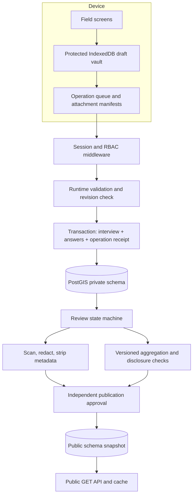

# Components and data flow

Planning baseline: 2026-11-07. Proposed design; no participant collection or product implementation has occurred.

Failure boundaries: metadata transaction succeeds independently of attachment completion; missing media remains unpublished. Job claims use DB locking, bounded retries and dead-letter review. Jobs include input revision and unique operation key to prevent duplicate derivatives. Public invalidation occurs on edits, consent changes and withdrawal before replacement publication.
