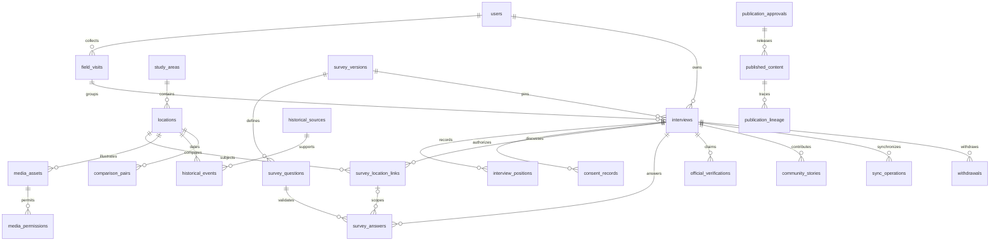

# Conceptual and logical database design

Planning baseline: 2026-11-07. Proposed design; no participant collection or product implementation has occurred.

All identifiers UUID unless stable taxonomy codes; all instants TIMESTAMPTZ UTC with original capture offset retained where relevant. Restricted schema stores source material; public schema is a separately written, allowlisted projection, not SELECT * over interviews. RLS is defense in depth; scoped service authorization and separate DB roles are mandatory. All FKs indexed; GiST on geometry, B-tree(state,study_area_id), (researcher_id,interviewed_at), (interview_id,revision), questionnaire code/version and job claim indexes. GIN/trigram names only if query profiling needs it.

Logical details for every entity follow in the data dictionary. ER approval edge represents release association, enforced through approval identifiers in payload/release transaction; lineage polymorphism needs transaction checks. Schema implementation must choose explicit join tables if integrity cannot be guaranteed by the module boundary.

Geometry is 2D EPSG:4326; interview points can be null only with explicit unavailable/denied state. Accuracy nonnegative when device supplied; no estimate inserted for manual pins. Preserve raw and effective coordinate separately and immutable provenance. Validate latitude/longitude ranges, capture/interview time divergence and out-of-area status without silently moving data. Study boundary changes trigger re-evaluation against a recorded boundary version.

Answers referencing a subject must belong to the same interview and questionnaire version; enforce composite FKs or transaction validation plus integration tests. Subject-level answer blocks avoid double-counting one opinion across multiple locations. An interview can have several topics, but stakeholder counts count distinct interview IDs; per-place totals can overlap and say so.

Lifecycle: draft → submitted → review → approved/changes_requested/rejected; places/media/history have candidate → reviewed → approved → published → archived/withdrawn. Published content is immutable per revision; edits invalidate and rebuild. Soft-delete referenced places (retain tombstone/name privately), reject newly linking archived places, preserve original interview semantics. Hard purge private participant material after approved retention/withdrawal review, respecting minimal noncontent audit and backup expiry; no cascade that unexpectedly removes unrelated place history.

Migrations: numbered SQL with checksum, transaction where supported, tested empty-db and upgrade paths, explicit extension provisioning and least-privilege roles; synthetic fixtures only. Expansion/compatibility before destructive contraction. Query patterns: bounded published bbox, normalized alias search, own visit interviews, lead review state/GPS quality, valid answers by subject/question/version, lineage invalidation on withdrawal, job retries. Public credentials cannot read raw tables even if API code is compromised.

## Questionnaire schema and immutable versions (issues #42, #43)
`packages/survey` defines an **instrument** as data: ordered questions with a code (`Q01`), a type (`yes_no`, `single`, `multi`, `integer_scale`, `text`), English-required localized prompts and option labels, `required`, optional `allowMissing`, and an optional `showIf` condition that may only refer to **earlier** questions (no cycles or forward references). An answer is exactly one of `{value}` or `{missing: reason}` with reasons `not_asked` (system only, for hidden questions), `skipped` (never for required questions), `refused`, `unsure`, `not_applicable`. "Unsure" or "refused" is never stored as a number; a scale answer must be an integer in range; options are checked against the pinned version; text is non-empty and length-limited; a hidden question carries no answer, so changing an earlier answer that hides a later one invalidates it. `validateAnswers` returns every problem and the list of visible questions for the renderer (#51) and the aggregator (#84).

Migration `0011_survey_versions.sql` stores each version whole (`instrument` jsonb) with its SHA-256 over the canonical JSON. A published version needs the hash, a time and a **named approving authority**, can then only move to `retired`, and cannot be edited, re-drafted, deleted or truncated even by the table owner (trigger); the API role has SELECT only, so publishing is a maintenance-path act (`SurveyPublisher`), never an HTTP route. `PgSurveyRepository` re-hashes every non-draft version on read and refuses a mismatch; `getUsable` returns only published, non-retired versions (drafts and retired versions cannot start interviews, #45). **Limits:** the only instrument in the repository is a SYNTHETIC test instrument; the real questionnaire needs the methodology decision (#4) and institutional/bilingual review (#11) and its approved text is not in this repository. Answer storage keyed to interviews arrives with the interview tables (#45, #47, #50); interviews will reference `survey_versions.id` so each pins one exact version.
