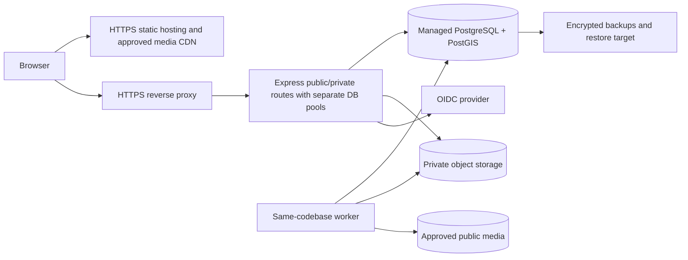

# Deployment, costs and observability

Planning baseline: 2026-11-07. Proposed design; no participant collection or product implementation has occurred.

Deployment options: managed static host + small managed container + managed PostGIS + S3-compatible storage offers lower operations; institution-hosted Linux VM with containers reduces vendor coupling but requires patching, monitored backups and on-call responsibility. Avoid assuming free tiers support PostGIS, no sleep, recovery or data residency. Public and private origins use separate cookie scope/CORS allowlist; same API deployment may route both with separate DB credentials. Staging uses synthetic data only, separate secrets and buckets. Production collection is disabled until gates pass.

No prices or accounts purchased. Cost model/month: static hosting + API/worker compute + database storage/backup + private/public object GB + bandwidth + map tile requests + optional panorama API. Candidate planning envelope INR 2,000–6,000/month is an unquoted budget hypothesis, not provider pricing; actual approved quotes, taxes, limits, region and spending cap required before purchase. Low-cost alternative is institution resources with explicit maintenance ownership. Set billing alerts/quotas and document free-tier expiry; optional Google/imagery costs default disabled.

Deploy migrations as a controlled job after backup; additive changes first, compatibility rollout, destructive changes only after retention review. Readiness validates DB/schema; liveness avoids expensive DB calls. Roll back code only if schema compatible; forward repair or restore rehearsal for destructive migrations. Public read-only outage has static methodology/fallback; field app shows saved vs synced truthfully.

Observe latency/error rate, queue backlog/retry age, failed scans, sync rejection/conflict rate, stale snapshots, backup age and disk/quota. No raw payload/GPS in logs. Provisional alerts: unsynced queue >24h, failed backup >24h, publication invalidation failures immediately. Role names describe responsibility; named maintainers and incident coverage must be assigned before launch.
