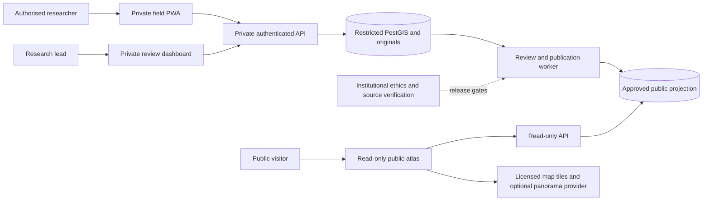

# System context and trust boundaries

Planning baseline: 2026-11-07. Proposed design; no participant collection or product implementation has occurred.

External IdP authenticates team accounts; it never authorizes publication alone. Device, browser, internet, application, database, object storage and third-party viewers are separate trust boundaries. Tile/viewer providers can observe visitor network requests; third-party embeds load only after user action with privacy notice.
