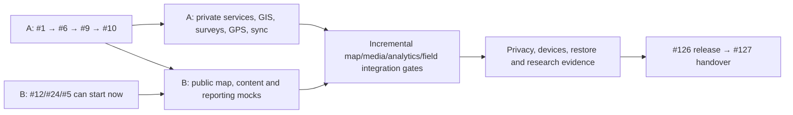

# Dependency map

Generated from developer-issue-allocation.json. No dates, product implementation or participant data. GitHub B assignment is pending invitation acceptance; labels reserve B work as requested. Issue #1 was completed concurrently in PR #137 and is preserved; remaining work begins at #6.

Authoritative current edges: [allocation JSON](developer-issue-allocation.json), [machine-readable dependency map](issue-dependencies.json), and [implementation order](implementation-order.md). The old single blocker category is now explicitly separated into hard, integration, soft and operational dependencies.

Hard edges: 255; integration edges: 113; soft: 10; operational: 2. Both hard and hard+integration graphs are acyclic.

No hard dependency was simply deleted: reclassified original blockers and their rationale are preserved per issue in allocation JSON and baseline snapshot. All actual issue numbers remain mapped to stable catalogue IDs.
