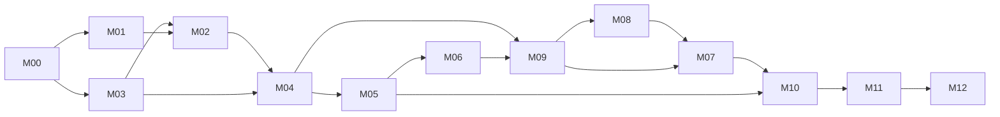

# Dependencies, workstreams and critical path

Planning baseline: 2026-11-07. Proposed design; no participant collection or product implementation has occurred.

Milestones overlap and are not a strict numbered waterfall: foundational M03 database grant design precedes M02 provisioning; M08 disclosure policy and M09 publication precede M07 live public API. Implementation DAG is authoritative; a milestone containing early and late work must not be treated as a single atomic dependency node.

Diagram is the coarse delivery-gate graph, not a substitute for issue edges (e.g. M08 eligibility requires early M09 review; M09 export requires later M08 suppression). Do not add blanket milestone edges to the issue graph.

Machine-readable complete edges: issue-dependencies.json. Every issue body links its actual blockers. Initial blocked status means dependencies await implementation, not a tool failure. Independent early workstreams after requirements: identity/grants, visual design, source/licence research and offline feasibility; later content collection, map presentation and field forms parallelize only after their listed dependencies.

Earliest safe implementation order (topological, not dates):

00.01 → 00.02 → 00.03 → 00.04 → 00.06 → 01.01 → 00.05 → 00.07 → 00.11 → 01.09 → 01.10 → 00.08 → 01.02 → 00.09 → 01.03 → 01.04 → 01.08 → 00.10 → 01.05 → 01.06 → 02.03 → 03.05 → 05.01 → 01.07 → 02.01 → 03.01 → 03.09 → 06.08 → 07.01 → 10.01 → 02.02 → 02.05 → 03.02 → 03.03 → 04.01 → 05.03 → 07.12 → 02.04 → 02.06 → 03.04 → 04.02 → 05.02 → 02.07 → 02.08 → 02.09 → 02.10 → 03.06 → 03.07 → 03.08 → 04.03 → 06.01 → 09.01 → 03.10 → 04.04 → 06.02 → 06.03 → 09.02 → 09.03 → 09.06 → 10.03 → 04.05 → 04.06 → 06.04 → 11.03 → 11.07 → 04.07 → 06.09 → 04.08 → 04.09 → 04.10 → 05.04 → 10.06 → 04.11 → 05.05 → 05.06 → 05.07 → 09.04 → 04.12 → 05.08 → 08.01 → 09.05 → 05.09 → 06.05 → 06.07 → 08.02 → 08.03 → 08.04 → 08.09 → 09.07 → 06.06 → 08.05 → 08.06 → 08.07 → 08.08 → 09.08 → 09.09 → 11.01 → 07.10 → 08.10 → 09.10 → 11.06 → 07.02 → 07.03 → 07.06 → 10.02 → 10.11 → 07.04 → 07.05 → 07.07 → 07.08 → 07.09 → 07.11 → 10.04 → 10.05 → 10.07 → 10.08 → 10.09 → 10.10 → 10.12 → 11.02 → 11.04 → 11.05 → 11.08 → 11.09 → 11.10 → 12.01 → 12.02 → 12.03 → 12.04 → 12.06 → 12.07 → 12.08 → 12.09 → 12.05

Longest core dependency chain by issue count (no durations supplied, so this is a structural critical path, not a calendar estimate):

00.01 → 00.02 → 00.03 → 00.06 → 00.07 → 00.08 → 00.09 → 00.10 → 03.01 → 03.03 → 03.04 → 04.03 → 04.04 → 04.06 → 04.07 → 04.08 → 04.09 → 05.04 → 05.07 → 05.08 → 09.07 → 09.08 → 07.10 → 07.03 → 07.11 → 10.09 → 10.12 → 11.02 → 11.04 → 11.05 → 11.08 → 11.09 → 11.10

MVP A/B/C and stretch scope: release-plan.md. First implementation verifies foundation issue 00.01; existing planning work is reviewed as evidence before closing, not automatically marked implemented.
