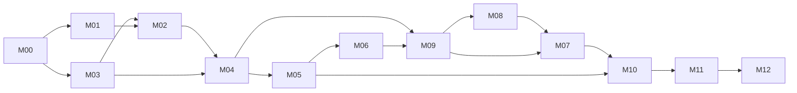

# Dependencies, workstreams and critical path

Planning baseline: 2026-11-07. Proposed design; no participant collection or product implementation has occurred.

Milestones overlap and are not a strict numbered waterfall: foundational M03 database grant design precedes M02 provisioning; M08 disclosure policy and M09 publication precede M07 live public API. Implementation DAG is authoritative; a milestone containing early and late work must not be treated as a single atomic dependency node.

Diagram is the coarse delivery-gate graph, not a substitute for issue edges (e.g. M08 eligibility requires early M09 review; M09 export requires later M08 suppression). Do not add blanket milestone edges to the issue graph.

Machine-readable complete edges: issue-dependencies.json. Every issue body links its actual blockers. Initial blocked status means dependencies await implementation, not a tool failure. Independent early workstreams after requirements: identity/grants, visual design, source/licence research and offline feasibility; later content collection, map presentation and field forms parallelize only after their listed dependencies.

Earliest safe implementation order (topological, not dates):

[#1](https://github.com/satvikp-coder/makarba-360/issues/1) → [#2](https://github.com/satvikp-coder/makarba-360/issues/2) → [#3](https://github.com/satvikp-coder/makarba-360/issues/3) → [#4](https://github.com/satvikp-coder/makarba-360/issues/4) → [#6](https://github.com/satvikp-coder/makarba-360/issues/6) → [#12](https://github.com/satvikp-coder/makarba-360/issues/12) → [#5](https://github.com/satvikp-coder/makarba-360/issues/5) → [#7](https://github.com/satvikp-coder/makarba-360/issues/7) → [#11](https://github.com/satvikp-coder/makarba-360/issues/11) → [#20](https://github.com/satvikp-coder/makarba-360/issues/20) → [#21](https://github.com/satvikp-coder/makarba-360/issues/21) → [#8](https://github.com/satvikp-coder/makarba-360/issues/8) → [#13](https://github.com/satvikp-coder/makarba-360/issues/13) → [#9](https://github.com/satvikp-coder/makarba-360/issues/9) → [#14](https://github.com/satvikp-coder/makarba-360/issues/14) → [#15](https://github.com/satvikp-coder/makarba-360/issues/15) → [#19](https://github.com/satvikp-coder/makarba-360/issues/19) → [#10](https://github.com/satvikp-coder/makarba-360/issues/10) → [#16](https://github.com/satvikp-coder/makarba-360/issues/16) → [#17](https://github.com/satvikp-coder/makarba-360/issues/17) → [#24](https://github.com/satvikp-coder/makarba-360/issues/24) → [#36](https://github.com/satvikp-coder/makarba-360/issues/36) → [#54](https://github.com/satvikp-coder/makarba-360/issues/54) → [#18](https://github.com/satvikp-coder/makarba-360/issues/18) → [#22](https://github.com/satvikp-coder/makarba-360/issues/22) → [#32](https://github.com/satvikp-coder/makarba-360/issues/32) → [#40](https://github.com/satvikp-coder/makarba-360/issues/40) → [#70](https://github.com/satvikp-coder/makarba-360/issues/70) → [#72](https://github.com/satvikp-coder/makarba-360/issues/72) → [#106](https://github.com/satvikp-coder/makarba-360/issues/106) → [#23](https://github.com/satvikp-coder/makarba-360/issues/23) → [#26](https://github.com/satvikp-coder/makarba-360/issues/26) → [#33](https://github.com/satvikp-coder/makarba-360/issues/33) → [#34](https://github.com/satvikp-coder/makarba-360/issues/34) → [#42](https://github.com/satvikp-coder/makarba-360/issues/42) → [#56](https://github.com/satvikp-coder/makarba-360/issues/56) → [#83](https://github.com/satvikp-coder/makarba-360/issues/83) → [#25](https://github.com/satvikp-coder/makarba-360/issues/25) → [#27](https://github.com/satvikp-coder/makarba-360/issues/27) → [#35](https://github.com/satvikp-coder/makarba-360/issues/35) → [#43](https://github.com/satvikp-coder/makarba-360/issues/43) → [#55](https://github.com/satvikp-coder/makarba-360/issues/55) → [#28](https://github.com/satvikp-coder/makarba-360/issues/28) → [#29](https://github.com/satvikp-coder/makarba-360/issues/29) → [#30](https://github.com/satvikp-coder/makarba-360/issues/30) → [#31](https://github.com/satvikp-coder/makarba-360/issues/31) → [#37](https://github.com/satvikp-coder/makarba-360/issues/37) → [#38](https://github.com/satvikp-coder/makarba-360/issues/38) → [#39](https://github.com/satvikp-coder/makarba-360/issues/39) → [#44](https://github.com/satvikp-coder/makarba-360/issues/44) → [#63](https://github.com/satvikp-coder/makarba-360/issues/63) → [#94](https://github.com/satvikp-coder/makarba-360/issues/94) → [#41](https://github.com/satvikp-coder/makarba-360/issues/41) → [#45](https://github.com/satvikp-coder/makarba-360/issues/45) → [#96](https://github.com/satvikp-coder/makarba-360/issues/96) → [#64](https://github.com/satvikp-coder/makarba-360/issues/64) → [#65](https://github.com/satvikp-coder/makarba-360/issues/65) → [#95](https://github.com/satvikp-coder/makarba-360/issues/95) → [#98](https://github.com/satvikp-coder/makarba-360/issues/98) → [#101](https://github.com/satvikp-coder/makarba-360/issues/101) → [#108](https://github.com/satvikp-coder/makarba-360/issues/108) → [#46](https://github.com/satvikp-coder/makarba-360/issues/46) → [#47](https://github.com/satvikp-coder/makarba-360/issues/47) → [#66](https://github.com/satvikp-coder/makarba-360/issues/66) → [#120](https://github.com/satvikp-coder/makarba-360/issues/120) → [#124](https://github.com/satvikp-coder/makarba-360/issues/124) → [#48](https://github.com/satvikp-coder/makarba-360/issues/48) → [#71](https://github.com/satvikp-coder/makarba-360/issues/71) → [#49](https://github.com/satvikp-coder/makarba-360/issues/49) → [#50](https://github.com/satvikp-coder/makarba-360/issues/50) → [#51](https://github.com/satvikp-coder/makarba-360/issues/51) → [#57](https://github.com/satvikp-coder/makarba-360/issues/57) → [#111](https://github.com/satvikp-coder/makarba-360/issues/111) → [#52](https://github.com/satvikp-coder/makarba-360/issues/52) → [#58](https://github.com/satvikp-coder/makarba-360/issues/58) → [#59](https://github.com/satvikp-coder/makarba-360/issues/59) → [#60](https://github.com/satvikp-coder/makarba-360/issues/60) → [#97](https://github.com/satvikp-coder/makarba-360/issues/97) → [#99](https://github.com/satvikp-coder/makarba-360/issues/99) → [#53](https://github.com/satvikp-coder/makarba-360/issues/53) → [#61](https://github.com/satvikp-coder/makarba-360/issues/61) → [#84](https://github.com/satvikp-coder/makarba-360/issues/84) → [#100](https://github.com/satvikp-coder/makarba-360/issues/100) → [#62](https://github.com/satvikp-coder/makarba-360/issues/62) → [#67](https://github.com/satvikp-coder/makarba-360/issues/67) → [#69](https://github.com/satvikp-coder/makarba-360/issues/69) → [#85](https://github.com/satvikp-coder/makarba-360/issues/85) → [#86](https://github.com/satvikp-coder/makarba-360/issues/86) → [#87](https://github.com/satvikp-coder/makarba-360/issues/87) → [#92](https://github.com/satvikp-coder/makarba-360/issues/92) → [#102](https://github.com/satvikp-coder/makarba-360/issues/102) → [#68](https://github.com/satvikp-coder/makarba-360/issues/68) → [#88](https://github.com/satvikp-coder/makarba-360/issues/88) → [#89](https://github.com/satvikp-coder/makarba-360/issues/89) → [#90](https://github.com/satvikp-coder/makarba-360/issues/90) → [#91](https://github.com/satvikp-coder/makarba-360/issues/91) → [#103](https://github.com/satvikp-coder/makarba-360/issues/103) → [#104](https://github.com/satvikp-coder/makarba-360/issues/104) → [#118](https://github.com/satvikp-coder/makarba-360/issues/118) → [#81](https://github.com/satvikp-coder/makarba-360/issues/81) → [#93](https://github.com/satvikp-coder/makarba-360/issues/93) → [#105](https://github.com/satvikp-coder/makarba-360/issues/105) → [#123](https://github.com/satvikp-coder/makarba-360/issues/123) → [#73](https://github.com/satvikp-coder/makarba-360/issues/73) → [#74](https://github.com/satvikp-coder/makarba-360/issues/74) → [#77](https://github.com/satvikp-coder/makarba-360/issues/77) → [#107](https://github.com/satvikp-coder/makarba-360/issues/107) → [#116](https://github.com/satvikp-coder/makarba-360/issues/116) → [#75](https://github.com/satvikp-coder/makarba-360/issues/75) → [#76](https://github.com/satvikp-coder/makarba-360/issues/76) → [#78](https://github.com/satvikp-coder/makarba-360/issues/78) → [#79](https://github.com/satvikp-coder/makarba-360/issues/79) → [#80](https://github.com/satvikp-coder/makarba-360/issues/80) → [#82](https://github.com/satvikp-coder/makarba-360/issues/82) → [#109](https://github.com/satvikp-coder/makarba-360/issues/109) → [#110](https://github.com/satvikp-coder/makarba-360/issues/110) → [#112](https://github.com/satvikp-coder/makarba-360/issues/112) → [#113](https://github.com/satvikp-coder/makarba-360/issues/113) → [#114](https://github.com/satvikp-coder/makarba-360/issues/114) → [#115](https://github.com/satvikp-coder/makarba-360/issues/115) → [#117](https://github.com/satvikp-coder/makarba-360/issues/117) → [#119](https://github.com/satvikp-coder/makarba-360/issues/119) → [#121](https://github.com/satvikp-coder/makarba-360/issues/121) → [#122](https://github.com/satvikp-coder/makarba-360/issues/122) → [#125](https://github.com/satvikp-coder/makarba-360/issues/125) → [#126](https://github.com/satvikp-coder/makarba-360/issues/126) → [#127](https://github.com/satvikp-coder/makarba-360/issues/127) → [#128](https://github.com/satvikp-coder/makarba-360/issues/128) → [#129](https://github.com/satvikp-coder/makarba-360/issues/129) → [#130](https://github.com/satvikp-coder/makarba-360/issues/130) → [#131](https://github.com/satvikp-coder/makarba-360/issues/131) → [#133](https://github.com/satvikp-coder/makarba-360/issues/133) → [#134](https://github.com/satvikp-coder/makarba-360/issues/134) → [#135](https://github.com/satvikp-coder/makarba-360/issues/135) → [#136](https://github.com/satvikp-coder/makarba-360/issues/136) → [#132](https://github.com/satvikp-coder/makarba-360/issues/132)

Longest core dependency chain by issue count (no durations supplied, so this is a structural critical path, not a calendar estimate):

[#1](https://github.com/satvikp-coder/makarba-360/issues/1) → [#2](https://github.com/satvikp-coder/makarba-360/issues/2) → [#3](https://github.com/satvikp-coder/makarba-360/issues/3) → [#6](https://github.com/satvikp-coder/makarba-360/issues/6) → [#7](https://github.com/satvikp-coder/makarba-360/issues/7) → [#8](https://github.com/satvikp-coder/makarba-360/issues/8) → [#9](https://github.com/satvikp-coder/makarba-360/issues/9) → [#10](https://github.com/satvikp-coder/makarba-360/issues/10) → [#32](https://github.com/satvikp-coder/makarba-360/issues/32) → [#34](https://github.com/satvikp-coder/makarba-360/issues/34) → [#35](https://github.com/satvikp-coder/makarba-360/issues/35) → [#44](https://github.com/satvikp-coder/makarba-360/issues/44) → [#45](https://github.com/satvikp-coder/makarba-360/issues/45) → [#47](https://github.com/satvikp-coder/makarba-360/issues/47) → [#48](https://github.com/satvikp-coder/makarba-360/issues/48) → [#49](https://github.com/satvikp-coder/makarba-360/issues/49) → [#50](https://github.com/satvikp-coder/makarba-360/issues/50) → [#57](https://github.com/satvikp-coder/makarba-360/issues/57) → [#60](https://github.com/satvikp-coder/makarba-360/issues/60) → [#61](https://github.com/satvikp-coder/makarba-360/issues/61) → [#102](https://github.com/satvikp-coder/makarba-360/issues/102) → [#103](https://github.com/satvikp-coder/makarba-360/issues/103) → [#81](https://github.com/satvikp-coder/makarba-360/issues/81) → [#74](https://github.com/satvikp-coder/makarba-360/issues/74) → [#82](https://github.com/satvikp-coder/makarba-360/issues/82) → [#114](https://github.com/satvikp-coder/makarba-360/issues/114) → [#117](https://github.com/satvikp-coder/makarba-360/issues/117) → [#119](https://github.com/satvikp-coder/makarba-360/issues/119) → [#121](https://github.com/satvikp-coder/makarba-360/issues/121) → [#122](https://github.com/satvikp-coder/makarba-360/issues/122) → [#125](https://github.com/satvikp-coder/makarba-360/issues/125) → [#126](https://github.com/satvikp-coder/makarba-360/issues/126) → [#127](https://github.com/satvikp-coder/makarba-360/issues/127)

MVP A/B/C and stretch scope: release-plan.md. First implementation verifies foundation issue [#1](https://github.com/satvikp-coder/makarba-360/issues/1); existing planning work is reviewed as evidence before closing, not automatically marked implemented.
